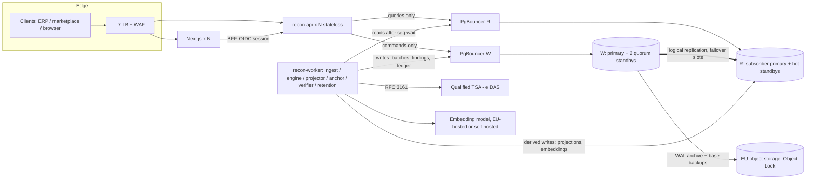

# Architecture.md

Status: **design**; the W/R DDL, ledger function and read-your-writes bridge semantics were validated on a PostgreSQL 18.6 pair (Progress.md §7). No application code exists. Targets below are design targets to be validated by load tests and game days; none is a measured claim.

Evidence base: docs/Research.md. Schema detail: DatabaseInfo.md. Hard rules: Rules.md.

---

## 1. Purpose and scope

An API service that continuously **reconciles a company's books against the copy each EU authority holds** (e-invoice clearance data, SAF-T, returns, customs import data, VIES) and emits **findings with cited legal basis and tamper-evident evidence packs**.

In scope (v1): ingest → normalise → reconcile (checks C1–C7, Research.md §3.4) → findings → evidence pack → dashboard.
Out of scope (v1): filing/submission to authorities, payroll/social security, transfer pricing/DAC6, PE risk, WHT, MAP, KYC/seller onboarding. Out-of-scope items are roadmap, not abandoned.

The service is **not a tax adviser**. Findings say "these two sources disagree under rule X (citation)". Legal conclusions remain with the customer's advisers (open decision D-5).

## 2. Hard architectural constraints (from the brief)

| Constraint | Realisation |
|---|---|
| Rust | Cargo workspace; Axum/Tokio/sqlx |
| Postgres + pgvector | PostgreSQL 18, pgvector 0.8.x in the read cluster |
| 1 database to **write** | **Write cluster (W)** — sole source of truth |
| 1 database to **read** | **Read cluster (R)** — separate cluster, derived, disposable |
| Fault tolerant | Quorum-sync HA for W; hot standbys for R; R rebuildable from W; WAL archive with Object Lock |
| Fidelity copy | Logical replication W→R **plus** continuous hash verification (§6) |
| Bridge between the 2 DBs | Replication + ledger-sequence read-your-writes bridge in `recon-store` (§5) |
| Frontend: shadcn + Lenis | Next.js + shadcn/ui + Lenis, scoped (§12) |
| Load balancing, horizontal scale, HA | Stateless API/FE replicas behind L7 LB; HPA; PDBs; multi-AZ (§8–9) |
| EU compliance | EU-only regions, GDPR-by-design, eIDAS timestamps, CI legal-evidence gates (Workflow.md) |

## 3. Logical architecture

### 3.1 Components

| Component | Responsibility | State |
|---|---|---|
| `recon-api` | HTTP API (Axum). Query handlers take `&ReadStore`; command handlers take `&WriteStore`. Auth, rate limit, idempotency, tenant context. | stateless |
| `recon-worker` | Subcommands: `ingest`, `engine`, `projector`, `anchor`, `verifier`, `retention`. Horizontally scalable; work claimed with `FOR UPDATE SKIP LOCKED`. | stateless |
| `recon-migrate` | Applies migrations to W and R in the correct order (§5.3). Only DDL path. | — |
| Frontend | Next.js App Router, shadcn/ui, Lenis. Talks only to `recon-api`. | stateless |
| W cluster | All authoritative data: tenants, source records, findings, rules, ledger, privacy keys. | durable |
| R cluster | Replicated copies + projections + vectors. Never authoritative. | rebuildable |
| Object storage | Raw uploaded files, evidence packs, WAL/base backups. EU region, versioned, Object Lock (compliance mode) on backups and evidence. | durable |

Deliberately absent in v1: Kafka, Redis, service mesh, Citus (§14). Reintroduce only against a measured need.

## 4. Data flow

1. **Ingest.** Client uploads (pre-signed URL to object storage) → `POST /v1/batches` registers `sha256`, source type, period. Idempotent via `Idempotency-Key`. Command writes `ingest.source_batch` + a ledger event in one W transaction. Returns `commit_seq` (the tenant ledger sequence of the event committed with the batch).
2. **Normalise.** `ingest` worker parses to canonical records (`ingest.source_record`; invoices mapped to an EN 16931-shaped canonical model with country CIUS adapters).
3. **Reconcile.** `engine` worker waits (bridge) until R's `ledger.chain_head.last_seq` for the tenant ≥ the batch's `commit_seq`, reads normalised records from R, evaluates the pinned **rule-pack version** deterministically, writes `recon.run` / `recon.finding` rows **to W**.
4. **Project.** `projector` reads replicated findings/ledger from R, writes denormalised projections and embeddings **into R's derived schemas**.
5. **Evidence.** `anchor` periodically obtains an RFC 3161 timestamp token for each tenant's ledger head hash → `ledger.chain_anchor` (W). Evidence packs are generated on demand from replicated data plus anchors.
6. **Read.** API queries R. Responses carry `X-Data-Watermark`; clients that just wrote pass `X-Min-Seq` (§5.2).

## 5. The bridge between W and R

### 5.1 Replication (the "fidelity copy" transport)
- W publishes `FOR TABLES IN SCHEMA core, ingest, recon, rules, ledger, privacy, ops` (explicit table lists for sensitive exceptions, see DatabaseInfo.md §publication).
- R subscribes with `failover = true`, `streaming = parallel`. W standbys run `sync_replication_slots = on` so the slot survives W failover.
- Replicated tables on R live in the same schema names (read-only by privilege). Derived data lives in R-only schemas `proj`, `vec`, `fidelity`.

### 5.2 Read-your-writes (ledger sequence token)
- **Every command appends at least one ledger event in the same W transaction as its change** (`ledger.append_event()`, Rules R-DB-6/R-API-2). The response returns `commit_seq` (header `X-Commit-Seq`): the tenant ledger `seq` of the last event it appended.
- A read with `X-Min-Seq: <n>` makes `ReadStore` poll `SELECT last_seq FROM ledger.chain_head WHERE tenant_id = $1` **on R** until `last_seq >= n` or `bridge.wait_ms` (default 1500, config) elapses → `503 replica_lag` + `Retry-After`. **No silent fallback to W.** Poll with short backoff (tens of ms).
- Why this is exact: logical replication applies each transaction atomically, in commit order; the event and the change commit together; so `last_seq >= n` on R implies the change is visible to the next R snapshot. Per-tenant appends are serialised until commit (DatabaseInfo §4.1), so `last_seq` never overtakes a lower, uncommitted `seq`.
- **Why not an LSN token** (the first design, rejected after testing on PostgreSQL 18.6, Progress.md §7): a post-commit `pg_current_wal_insert_lsn()` token is **not reliably reachable** through R's `pg_replication_origin_status.remote_lsn` — once any non-replicated WAL follows the commit (e.g. the `api.idempotency_key` write that every command makes, other databases, checkpoints) `remote_lsn` stays behind the token and the wait stalls until timeout. `pg_stat_subscription.latest_end_lsn` did reach it, but means "received", not "applied", so it cannot prove visibility. LSNs are used for **lag monitoring only**.
- Reads without a token are eventually consistent and flagged by `X-Data-Watermark` (timestamp of the last applied commit).
- Only the `bridge` module in `recon-store` may implement this waiting; no other code reads `chain_head` for synchronisation. Enforced by module visibility (Rules.md R-DB-4).

### 5.3 Schema changes (DDL is not replicated)
`recon-migrate` uses **expand/contract** with strict order:
- Additive: apply to **R first**, then W (subscriber must accept new columns before publisher sends them).
- Destructive: stop writing in app code → drop on **W**, then **R**.
- Each migration file is tagged `target = both | w | r`; CI verifies both clusters converge to the identical replicated-schema fingerprint (DatabaseInfo.md §fidelity).
- Sequences are not replicated → primary keys are **UUIDv7** (`uuidv7()`, PG 18); no replicated table uses a sequence default.
- **Order matters (verified on PostgreSQL 18.6):** adding a column on W first made the publisher send a column R did not have; R's apply worker errored (`apply_error_count` 0 → 3) and the **entire subscription stalled, including unrelated tables**, until the column existed on R. R-first produced no errors. Therefore: `recon-migrate` enforces order; alert (P1) on `pg_stat_subscription_stats.apply_error_count` increasing.

### 5.4 Roles
Separate DB roles per component per cluster; no application credential exists that can write R's replicated tables or read W from a query path (DatabaseInfo.md §roles). The API service holds *both* a W-command credential and an R-query credential, but the type system (separate `WriteStore`/`ReadStore`) and grants make cross-use impossible without a deliberate, reviewed change.

## 6. Fidelity verification

Logical replication gives *logical* equality, not byte identity. Fidelity is therefore **asserted by continuous verification**, not assumed.

- **Ledger (append-only):** exact. Verifier recomputes the hash chain on R from `seq` ranges and compares each chain head to W's; any divergence is a P1 alert. Chains are also externally anchored (§10).
- **Mutable tables:** range-hash comparison over primary-key ranges (`md5/sha256` of canonically ordered row text). Two-pass: ranges that differ are re-compared after a settle delay; only **persistent** mismatches alert (avoids false positives from in-flight changes).
- **Cadence:** ledger heads every minute; full-table range sweep at least daily per table, hot tables more often. Results stored in `ops.fidelity_check` (W, replicated).
- **Schema fingerprint:** hash of catalog definition for replicated tables on both clusters; mismatch blocks deploys.
- **Disaster test:** monthly restore of W backup to a scratch cluster, chain verification, and R rebuild drill (`copy_data = true` from scratch), recorded.

## 7. Consistency and failure semantics

| Event | Behaviour |
|---|---|
| W primary fails | Operator promotes a quorum-sync standby (RPO 0 by design). Writes get `503 Retry-After` during promotion (target < 60 s). Reads continue from R with a growing watermark age. Subscription resumes via synchronised slot. |
| W entire AZ lost | Quorum (`ANY 1` of 2 standbys across 3 AZs) still commits. |
| W region lost | Async DR standby in a second **EU** region; manual promote; RPO > 0 possible (target ≤ 5 min), declared in customer SLA. |
| R primary fails | Promote hot standby. R is derived → no RPO requirement. If both lost: rebuild from W (runbook; hours, not minutes — hence 2 R nodes minimum). API reads return 503, **never** redirected to W. |
| Replication lag spikes | Alert at 5 s p99. Beyond `bridge.wait_ms`, tokenised reads fail fast. Engine pauses new runs. |
| Slot invalidated | Page. Runbook: recreate subscription with `copy_data = true`, then verifier full sweep. |
| TSA unavailable | Anchoring retries with backoff; ledger keeps appending (hash chain already tamper-evident); anchor lag alert. Evidence packs state the latest anchored `seq`. |
| Poison ingest file | Worker marks batch `failed` with reason; no partial effects (single transaction per batch stage). |

Idempotency: all POSTs require `Idempotency-Key` (stored with request hash + response in `api.idempotency_key`, W). Worker stages are idempotent and resumable.

## 8. High availability and load balancing

| Layer | Mechanism | Design target (unvalidated) |
|---|---|---|
| Edge | Managed L7 LB with health checks, multi-AZ; WAF | — |
| API / FE | ≥3 replicas across AZs; PodDisruptionBudgets; readiness gates on DB reachability; graceful drain | zero-downtime deploy |
| Postgres W | 3 instances / 3 AZs, quorum sync commit, operator-managed failover, PgBouncer | RPO 0 in-region; RTO < 60 s |
| Postgres R | primary + ≥1 hot standby; read load across standbys | RTO < 2 min; lag p99 < 5 s |
| Backups | continuous WAL archive + daily base backup → EU object storage, Object Lock (compliance mode) | restore drill monthly |
| DR | async standby in second EU region | RPO ≤ 5 min; RTO ≤ 4 h |
| API SLO | initial **99.9 %** monthly; revisit after 2 quarters of data | — |

No 99.99 % claim is made: it would require validated multi-region active/active behaviour that this design does not include.

Filing-deadline calendar: HA windows get change freezes around customer-critical dates (Workflow.md §release).

## 9. Horizontal scaling

- **API / FE:** HPA on CPU + in-flight requests. Stateless; sessions in signed cookies / OIDC tokens.
- **Workers:** scale on queue depth; `SKIP LOCKED` claims; per-tenant concurrency caps to prevent noisy neighbours.
- **R reads:** add hot standbys. Tune `hot_standby_feedback` / `max_standby_streaming_delay` to avoid query-conflict cancellations (measure).
- **W writes:** single-writer. Controls: batch events per transaction; per-tenant ledger head row lock (serialises one tenant, not all); later hash-partition large tables by `tenant_id`. If one writer is ever insufficient, the next step is tenant-sharded W clusters (router in `recon-store`), not Citus — decided when measurements demand.
- **pgvector:** HNSW on R only; legal corpus is small relative to HNSW limits. Tenant data is not embedded (§11).
- **Capacity:** no load figures were supplied. Phase 1 sets targets using k6 against a realistic synthetic data set (Workflow.md).

## 10. Legal-evidence architecture

| Need | Mechanism |
|---|---|
| Tamper evidence | Per-tenant append-only **hash chain** (`ledger.audit_event`): `hash = SHA-256(prev_hash ‖ canonical fields ‖ payload_sha256)`; payload canonicalised per RFC 8785 (JCS). UPDATE/DELETE/TRUNCATE blocked by privileges **and** triggers. |
| Trusted time | `anchor` worker timestamps the chain head via **RFC 3161** with a **qualified** trust service provider where available. Qualified electronic timestamps carry a presumption of date/time accuracy under eIDAS Arts. 41–42 (Research.md §5). Chain heads make Merkle trees unnecessary: timestamping the head covers all prior events. |
| Evidence pack | ZIP: `manifest.json` (finding, rule-pack version, citations, input record hashes), source record extracts, chain segment, anchor token(s), verification script. Verifiable offline with the open verifier CLI (`recon-verify`). Packs stored with Object Lock. |
| Determinism | Findings are a pure function of (input record hashes, rule-pack version). Re-running reproduces identical output; engine records both in the finding. |
| Erasure vs. retention | PII never stored in ledger payloads (opaque `subject_ref`). PII fields encrypted with per-subject DEKs wrapped by an EU KMS key; erasure = **crypto-shred** (delete wrapped DEK on W → replicated to R; disable KMS key version). Retention is **per jurisdiction data** (`privacy.retention_policy`), subject to legal holds; erasure requests under Art. 17 are refused/deferred where Art. 17(3)(b) applies, and that decision is itself logged. |

## 11. Vector / AI layer

- pgvector lives **only in R** (`vec` schema). Embeddings are derived data produced by `projector`; they never enter W.
- Corpus: public legal text (EUR-Lex, national guidance, ECJ case summaries), curated rule-pack commentary, and customer-agnostic product/HS descriptions. **No tenant PII and no raw tenant records are embedded** (embedding inversion risk; Rules.md R-AI-2).
- Uses: (1) retrieve citations for a finding's explanation; (2) suggest rule-pack entries for human review; (3) "similar finding" lookup within a tenant's own derived projections (non-PII features only).
- **AI is advisory.** Deterministic rules decide findings. LLM output never becomes a finding, citation, or legal statement without matching a retrieved source chunk id (Rules.md R-AI-1, R-AI-3).
- Embedding model must run in the EU (self-hosted or EU-region provider with Art. 28 DPA). Model, dimension and version are recorded in `vec.model`; changing models = new table + re-embed, not an in-place update. Open decision D-4.
- AI Act: advisory retrieval over public text is not an Annex III use case on current reading; re-assess on scope change (Research.md §5). Counsel to confirm.

## 12. Frontend

- Next.js (App Router) + React + Tailwind + **shadcn/ui** (copied into repo, owned by us). TanStack Query for server state; API client generated from the OpenAPI spec (`utoipa` → `openapi-typescript`) so contracts cannot drift (CI gate).
- Auth: OIDC code flow in the Next.js server (BFF); browser holds only an HttpOnly session cookie.
- **Lenis scoping:** Lenis honors `prefers-reduced-motion` by default (smoothing off) — keep that default. Use it on marketing/overview pages. In app views with nested scrollers (data tables, Radix dialogs/sheets/popovers, command palette), mark those containers `data-lenis-prevent` to avoid scroll hijacking; virtualised tables are excluded. Lenis never drives anything that affects correctness.
- Accessibility target **WCAG 2.2 AA**; axe-core in CI. i18n from day 1 (EN, then RO and country languages per pilot); no hard-coded strings.
- Deployment: static assets on CDN, SSR containers stateless behind the same LB.

## 13. Security

- TLS 1.3 everywhere; mTLS between API and workers' internal endpoints and to Postgres (`verify-full`).
- AuthN: OIDC for humans (EU-hosted IdP), API keys for machines (hashed at rest, prefix-indexed, scoped, rotatable), optional mTLS-bound keys for enterprise.
- AuthZ: tenant-scoped RBAC; Postgres **RLS** on `tenant_id` in both clusters; tenant bound per transaction with `SET LOCAL app.tenant_id` (compatible with PgBouncer transaction pooling).
- Secrets: EU KMS / Vault; never in env files in repo. Application-layer envelope encryption for tax IDs, IBANs, names.
- Supply chain: SBOM (CycloneDX), `cargo-deny`, `cargo-audit`, npm audit/osv, pinned actions by SHA, signed images (cosign), provenance attestation.
- Logs/traces: structured, **PII-free by construction** (typed redaction wrappers; tests).
- Tenant isolation proof: cross-tenant test suite runs against both clusters in CI.

### 13.1 Request hardening (built; each item names the test that proves it)

**Two listeners, one set of handlers.** `recon-api` serves a *public* listener (`RECON_BIND`, default `127.0.0.1:8080`: customers, `Authorization: Bearer rk_…`) and an *internal* listener (`RECON_INTERNAL_BIND`, default `127.0.0.1:8081`: our own services, today the Next.js BFF). The internal one additionally requires (a) a client IP inside `RECON_INTERNAL_ALLOWED_CIDRS` and (b) a `RECON-SVC-V1` request signature (HMAC-SHA256 over method, path+query, timestamp, nonce and body hash; ±60 s skew, nonce accepted once per key id within 120 s, several keys active for rotation; spec and shared test vectors in `crates/recon-api/src/service.rs` and `crates/recon-api/tests/vectors/`). The process **refuses to start** without `RECON_INTERNAL_ALLOWED_CIDRS` and `RECON_SERVICE_KEYS`. The client IP is the TCP peer; `X-Forwarded-For` is read only when the peer is in `RECON_TRUSTED_PROXY_CIDRS` (right-most untrusted hop). Tests: `service::tests`, `net::tests`, `tests/security.rs::the_internal_listener_demands_source_ip_signature_and_api_key`.

**Input.** Every body is a typed struct with `deny_unknown_fields`, duplicate keys are refused, `Content-Type: application/json` is required (415), bodies are limited per route (8 KiB for `POST /v1/batches` and `POST /v1/recon/runs`, none for GET; 413, checked on `Content-Length` before authentication and on the stream), URI ≤ 4 KiB (414), headers ≤ 64 fields / 4 KiB per value / 16 KiB total (431; hyper's own larger cap applies first). Ids are canonical UUIDs, `sha256` is 64 lower-case hex, dates are real calendar dates 1990–2100 with start ≤ end, `source_type` is a closed set (`erp_ledger`, `authority_clearance`: the kinds the C1 check consumes), `object_uri` is `https://` or `s3://` only with a plain host, `Idempotency-Key` is 1–128 characters of `[A-Za-z0-9._:~-]`, `limit` is 1–200 (refused, not clamped). Strings with control characters, zero-width/BOM characters or bidirectional overrides are rejected (`invalid_characters`); nothing is HTML-escaped on the way in. All accepted request strings are ASCII, hence already NFC; a future free-text field must add NFC handling. Rejections use the stable error shape with fixed messages and never echo input. SQL is parameterised only; `tests/security.rs::hostile_sql_text_is_stored_and_returned_as_plain_data` proves a hostile string round-trips as data. Tests: `validate::tests`, `tests/security.rs::bad_bodies_ids_queries_and_headers_are_refused_with_stable_codes_and_no_echo`.

**Output.** Every API response (errors, 404, 405, 429 included) carries `X-Content-Type-Options: nosniff`, `Cache-Control: no-store`, `Content-Security-Policy: default-src 'none'; frame-ancestors 'none'`, `Referrer-Policy: no-referrer`, `Cross-Origin-Resource-Policy: same-origin`. Stored text that looks like markup is returned as a JSON string (`tests/security.rs::every_response_carries_the_security_headers_and_a_script_payload_stays_a_json_string`). Escaping for HTML is the renderer's job (the frontend: React escapes; no `dangerouslySetInnerHTML` is used). Responses that hyper rejects before routing (malformed HTTP) do not pass through these layers.

**Rate limits (in process, per replica).** Token buckets with injectable clock (`ratelimit::tests`): a per-client-IP bucket *before* authentication (public listener; IPv6 per /64), then per-API-key and per-tenant buckets after authentication with separate, lower quotas for POST. Defaults live in `guard::RateLimits` (IP 600/min burst 100; key read 600/100, write 60/20; tenant read 1200/200, write 120/40) and are overridable by `RECON_RATE_*`; they protect the service and are not plan quotas. 429 carries `Retry-After` and `RateLimit-Limit/Remaining/Reset`. Memory is bounded: idle (fully refilled) buckets are swept; at the cap (`RECON_RATE_MAX_KEYS`, default 100 000 per limiter) unknown keys are refused until entries recover. Argon2id verification is capped (`RECON_ARGON2_CONCURRENCY`, default 4; a request waits up to `RECON_ARGON2_WAIT_MS`, default 500, then `503 busy`), and a token that is not shaped like a key costs no Argon2 at all. **Limitation:** no shared state (no Redis in v1, §14), so with N replicas a caller's effective limit is up to N× the configured one, and the service-signature nonce cache is per replica too (a signed request could be replayed once to each other replica within its 60 s window).

**Frontend.** Pages carry a per-request nonce CSP from `proxy.ts` (`lib/csp.ts`): scripts by nonce + `strict-dynamic` only, `object-src 'none'`, `base-uri 'self'`, `form-action 'self'`, `frame-ancestors 'none'`, `upgrade-insecure-requests` in production; the single concession is `style-src-attr 'unsafe-inline'` (server-rendered `style=""` attributes cannot carry a nonce). Rendering is therefore dynamic for every page. `next.config.ts` adds HSTS (production), `nosniff`, `Referrer-Policy: strict-origin-when-cross-origin`, a `Permissions-Policy` denying camera, microphone, geolocation and other powerful features, COOP/CORP `same-origin` and `X-Frame-Options: DENY`. The BFF reaches the API only through the internal listener, with a signature, for an allowlist of v1 GET routes and query parameters, forwarding a fixed set of headers (`lib/bff.ts`, `tests/bff.test.ts`).

**Database network access.** `infra/postgres/` holds a `pg_hba.conf` template (`hostssl`, `scram-sha-256` + client certificate, per-role per-database lines, replication role reachable only from R, final `reject`) and its README; it is a template, not deployed (provider undecided, D-2).

**Not built:** TLS termination for either listener (assumed at the platform edge), mTLS, shared rate-limit state, per-plan quotas.

## 14. Rejected / deferred alternatives

| Option | Why not (now) |
|---|---|
| Kafka/Redpanda + Debezium | Extra moving parts; Postgres logical replication already provides ordered change feed to R; ledger gives ordered per-tenant events. Revisit if non-Postgres consumers appear. |
| Full event sourcing | Heavy. Chosen: relational state + append-only hash-chained audit ledger + deterministic re-runs. |
| `postgres_fdw` between W and R | Creates a query path across the separation boundary; defeats "1 reads / 1 writes". |
| Citus / sharding now | No measured need; operational cost. Tenant-sharded W is the planned escape hatch. |
| Redis | Idempotency + queues live in W; rate limiting at the edge LB/gateway. Add only if measured. |
| Service mesh (Istio) | mTLS can be done with cert-manager + app config at this size. |
| Serverless compute | Long-running workers, connection pooling, and EU-region/portability favour containers. |
| Blockchain anchoring | RFC 3161 qualified timestamps have explicit eIDAS legal presumption; public chains do not. |
| SaaS LLM API on tenant data | Transfer + inversion risk (Rules.md R-AI-2). |

## 15. Observability and operations

OpenTelemetry traces/metrics/logs; Prometheus + Grafana (or managed EU equivalent). Mandatory SLIs: API availability/latency, replication lag (bytes and seconds), subscription `apply_error_count`, slot retained WAL, fidelity mismatches, anchor lag, worker queue depth, per-tenant error rate. Alerts map to runbooks in `docs/runbooks/` (to be created in Phase 1).

## 16. Deployment topology

Kubernetes in an **EU-only** region set (provider undecided, D-2). Declarative Postgres via an operator — **CloudNativePG proposed** (supports quorum sync, backup to object storage, logical slot failover synchronisation per docs referenced in Research.md §6); Patroni is the acceptable alternative. Phase 1 includes a spike that proves, on a throwaway cluster: failover of W while R's subscription keeps flowing with no data loss, and R rebuild. The design is not accepted until that spike passes.

## 17. API surface (v1 sketch, OpenAPI is source of truth once written)

| Method & path | Side | Notes |
|---|---|---|
| `POST /v1/batches` | W | register upload; idempotent; returns `commit_seq` |
| `GET /v1/batches/{id}` | R | status |
| `POST /v1/recon/runs` | W | pin rule-pack version; async |
| `GET /v1/recon/runs/{id}` | R | |
| `GET /v1/findings` | R | filters: check, severity, period, jurisdiction |
| `GET /v1/findings/{id}/evidence` | R | evidence pack (signed URL) |
| `GET /v1/rules/search` | R | hybrid keyword + vector over legal corpus |
| `POST /v1/privacy/erasure-requests` | W | |
| `GET /v1/privacy/export` | R | Art. 20 portability, machine-readable |
| Webhooks | W→client | run completed, finding raised; signed |

Versioning: URL major version; additive-only within a major; deprecation ≥ 12 months.

## 18. Open decisions (owner needed)

See Progress.md D-1…D-8. Architecture holds under any resolution except D-5 (tax-advice positioning), which may change finding wording and UI, and D-2 (provider), which may change the Postgres operator.

## 19. Billing (subscriptions)

Status: **implemented as a library and migration, not deployed, live Stripe not exercised.** Crate `crates/recon-billing`, migration `migrations/w/0008_billing.sql`; tested against real PostgreSQL 18 and a local fake of the Stripe API on 2026-10-25. Plan prices are **data** inserted by an operator (`recon-billing-seed`); the repository contains no price.

| Concern | Realisation |
|---|---|
| Where billing data lives | Cluster **W only**, schema `billing`; not in publication `recon_pub`, no R migration, not in the replicated-schema fingerprint. Payment data never reaches R. |
| Why handlers read W | Billing rows are not replicated, so `GET /billing/subscription` and `check_and_consume` read W. This is a deliberate, documented exception to "queries use R" (like credential lookup in `recon-api::auth`); the billing code holds a `WriteStore` only (R-DB-1) and never falls back from R to W (R-DB-5). |
| Plans and entitlements | `billing.plan` (code, interval month/year, currency, `unit_amount_minor`, i18n `display_key`, `valid_from/valid_to`, optional `provider_price_id`) and `billing.plan_entitlement` (numeric limit or boolean per key: `runs_per_month`, `records_per_month`, `legal_entities`, `users`, `countries`, `api_keys`, `evidence_packs`, `support_tier`). Rows are immutable (trigger): a new price or new limits is a new row; the old row is retired with `valid_to`, existing subscriptions keep theirs. |
| Tenant without subscription | The one open-ended *fallback* plan (`is_fallback`, free/sandbox) **if such a row exists**; otherwise no plan and every consumption is denied (fail closed). |
| Metered usage | `billing.consume_usage()`: one conditional `UPDATE` on the counter row inside a tenant-bound transaction, so concurrent callers cannot exceed the limit; idempotent per `(tenant, metric, idempotency key)`. The window is the subscription's current period (rolled forward in whole intervals when a renewal event is late); the fallback plan counts per UTC calendar month. |
| Payment trouble | `past_due` keeps working for a configurable grace (default 14 days = Stripe's recommended Smart Retries window, which is configurable in the Stripe Dashboard and must be kept in step); after it, and for a subscription whose period ended more than the grace ago with no renewal event, access is **read-only: no new consumption**. Billing never deletes or hides data. |
| Checkout and portal | `POST /billing/checkout` (Stripe Checkout, `mode=subscription`, price from `billing.plan.provider_price_id`, tenant id as `client_reference_id` and subscription metadata) and `POST /billing/portal` (Stripe Billing Portal). Return URLs must match `BILLING_ALLOWED_RETURN_ORIGINS`. The Stripe API version is pinned per request (`2026-09-30.endive`, https://docs.stripe.com/api/versioning, accessed 2026-10-25). |
| Webhook | `POST /billing/webhook`: `Stripe-Signature` (`t=`, `v1=`, HMAC-SHA256 over `t.payload`, constant-time, several `v1` accepted, 5-minute tolerance) is verified over the raw body before anything is parsed (https://docs.stripe.com/webhooks, accessed 2026-10-25). Events are applied once per provider event id (`billing.provider_event` UNIQUE) in one tenant-bound transaction; any failure is a 5xx so Stripe retries (up to three days in live mode). Handled: `checkout.session.completed`, `customer.subscription.created|updated|deleted`, `invoice.paid`, `invoice.payment_failed`. Subscription state comes from `customer.subscription.*`; invoices only produce reference rows. Out-of-order events are ignored by a per-row `provider_event_created` guard. |
| Ledger | Subscription creation, plan change, status change (including cancellation) and cancel-at-period-end changes append events through `ledger.append_event()` inside the same transaction: `billing.subscription.created`, `…plan_changed`, `…status_changed`, `…cancel_at_period_end_changed`. Payloads carry opaque ids, the plan code and the provider event id only. |
| Mounting | The webhook belongs on the **public** listener without the API-key layer (it authenticates by Stripe's signature, not by the internal service signature). The three tenant routes are mounted behind the API's authentication, which must put `recon_billing::TenantId` into the request extensions; without it they answer `401`. |

Data minimisation and residency: **no reconciliation data and no tenant name is ever sent to Stripe.** Stripe receives the tenant UUID and plan UUID (as `client_reference_id`/metadata), the price id, the return URLs, and whatever the customer types on Stripe's hosted pages (billing name, address, VAT id, e-mail, card), which Stripe stores; this crate stores none of that. Stripe is a US-parented processor: whether and under which transfer mechanism data reaches the US is **unverified** and is a DPO/counsel decision (docs/privacy/ROPA.md §10, SUBPROCESSORS.md, TIA.md); it must be settled before any live key is configured.

Not built / not verified: live Stripe (no keys were available), tax calculation and VAT-ID validation on checkout (Stripe Tax is not enabled by this code), dunning e-mails (Stripe's), proration policy, refunds, a metering call site in `recon-api` and `recon-engine` (the library is ready; wiring is the API owner's), purge of old `billing.usage_consumption` rows, and CI wiring (L4 does not read the `billing` schema: it scans only the replicated schemas and its `UNPUBLISHED_SCHEMAS` list holds `api` alone).

Operator setup (none of it performed): one Stripe Price per plan row, its id stored in `billing.plan.provider_price_id` (`recon-billing-seed`); one webhook endpoint with a **snapshot** payload pinned to API version `2026-09-30.endive` for the six event types above, its `whsec_…` secret in `STRIPE_WEBHOOK_SECRET` (two secrets, comma-separated, while it is being rolled); the Dashboard retry window set to match `BILLING_PAST_DUE_GRACE_DAYS`; `STRIPE_SECRET_KEY` (the code only calls `POST /v1/checkout/sessions` and `POST /v1/billing_portal/sessions`; which restricted-key permissions cover them is unverified) and `BILLING_ALLOWED_RETURN_ORIGINS` only via the environment. The webhook secret and API key are never logged and never reach the ledger.
