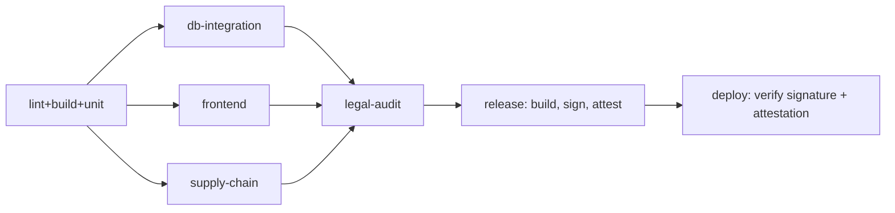
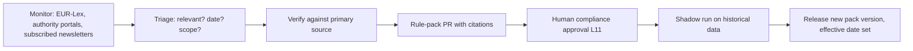

# Workflow.md

Status: **specification**. No workflow files exist yet; they are created in Phase 1 and must match this document (CI doc-drift check, R-DOC-3). Tool names are the intended choices; each is confirmed by running it when the pipeline is built.

---

## 1. Source control

- Trunk-based. Short-lived branches, PR required, squash merge, Conventional Commits, **signed commits** (R-GEN-3).
- Branch protection on `main`: required status checks (all of §3), ≥1 approving review, CODEOWNERS review for gated paths, no force-push, linear history.
- CODEOWNERS (gated paths → team): `rules/`, `docs/privacy/`, `migrations/`, `crates/recon-evidence/`, `infra/policies/` → **@compliance** (human owners; named in Progress.md D-5) plus engineering.

## 2. Local development (planned)

- `docker compose`: two PostgreSQL 18 instances (`w`, `r`) + PgBouncer each + object-storage emulator (S3-compatible) + OIDC dev IdP.
- `recon-migrate` bootstraps roles, schemas, publication/subscription, and verifies the fingerprint. The same bootstrap is used in CI.
- Tests that touch the database run against this real pair (testcontainers in CI). Mocked DBs are not accepted for replication, RLS, ledger, or grant behaviour (R-GEN-2).

## 3. CI pipeline

| Job | Content | Fails on |
|---|---|---|
| `lint-build-unit` | `cargo fmt --check`, `cargo clippy -D warnings` (incl. `unwrap_used`, `expect_used` on non-test; `forbid(unsafe_code)`), `cargo test` (non-DB) | any |
| `db-integration` | Start W+R Postgres 18 with logical replication; run migrations via `recon-migrate`; run: replication convergence + schema fingerprint, **RLS/cross-tenant suite on both clusters**, **role-grant suite** (R-DB-7/12), **ledger tests** (append function rejects forks; triggers block mutation; hash vectors; verifier on R), **bridge tests** (read-your-writes; lag ⇒ 503; no W fallback), **failover test** (kill W primary in the operator test environment; subscription resumes; no data loss) — the latter in a nightly job if too slow for PRs | any failure |
| `frontend` | typecheck, lint, unit, Playwright (incl. Lenis scoping and reduced-motion), axe-core, OpenAPI-client drift check, i18n string lint | any |
| `supply-chain` | see L1–L3 | see below |
| `legal-audit` | see §4 | see §4 |
| `release` | build images, SBOM (CycloneDX), cosign sign + provenance, attach `legal-audit-report.json` attestation | any |
| `deploy` | verify signature, provenance, and legal-audit attestation **before** rollout; staged: staging → canary → full | verification failure |

All third-party Actions pinned by commit SHA; `permissions: contents: read` by default; cloud access via OIDC federation, not stored keys (R-SEC-2/7).

## 4. Legal-audit stage ("PASS OF LEGAL AUDITS")

### 4.1 What "PASS" means — and does not mean

**PASS** = every automated evidence gate below is green **and** the required human approvals for touched gated paths exist. It is a machine-checkable *evidence and control* gate.

It is **not** a legal opinion and does **not** certify compliance with GDPR, VAT law, eIDAS, NIS2, DORA or the AI Act. No CI job can. Legal compliance requires counsel/DPO review, which this stage enforces *as a prerequisite* (L5, L11) but cannot replace. The report says so in its header.

### 4.2 Gates

| ID | Gate | Tool / method | Fails when | Evidence emitted |
|---|---|---|---|---|
| **L1** | Licence policy | `cargo-deny` (licences), npm licence checker, allowlist in `deny.toml` | disallowed or unknown licence | licence inventory |
| **L2** | Vulnerabilities + SBOM | `cargo-audit`/`cargo-deny advisories`, `osv-scanner` (npm, containers), CycloneDX SBOM | known vuln above threshold without a dated, reviewed waiver | SBOM, scan report |
| **L3** | Secret scan | `gitleaks` over full diff + history on schedule | any finding | scan report |
| **L4** | **Data classification** | Spin up ephemeral W, apply migrations, read `COMMENT ON COLUMN` for every column in replicated schemas, parse `class/basis/retention/encrypted` | unclassified column; `class∈{pii,pii_id}` without `encrypted=true` (or documented exception); `retention` not in `privacy.retention_policy` data classes; replicated table with sequence default | classification report; **ROPA diff** (Art. 30 draft) |
| **L5** | **Privacy docs freshness** | parse front matter of `docs/privacy/{DPIA,ROPA,TIA,SUBPROCESSORS}.md`; compare ROPA with L4 diff | file missing; `next_review` passed; L4 ROPA diff not reflected; sub-processor in IaC not in SUBPROCESSORS.md | doc status table |
| **L6** | **Erasure & retention behaviour** | integration tests: crypto-shred ⇒ plaintext unrecoverable on W and R; legal hold blocks purge; purge writes ledger event; Art. 17(3)(b) deferral path logged | any assertion fails | test report |
| **L7** | **Ledger integrity** | tests: chain verifies end to end on W and R; forks rejected; mutation blocked; anchor token verifies (RFC 3161 parse + hash match) against test TSA | any | test report |
| **L8** | **Rule-pack citations & freshness** | parse `rules/**`: each rule has `source_ref`, `article`, `accessed_on`, `valid_from`; URL/CELEX syntactic check; (nightly) link liveness; `last_reviewed` age | missing citation; unparseable ref; pack >180 days since review; (warn + auto-issue at >90 days; dead link warns) | rule register export |
| **L9** | **E-invoice conformance fixtures** | validate canonical invoices and country-profile fixtures against EN 16931 / CIUS schemas + Schematron for each *enabled* country; schema versions read from rule packs | fixture invalid, or enabled country lacks fixtures for current schema version | validation report |
| **L10** | **Infrastructure policy (residency, encryption, exposure)** | `conftest`/OPA over Terraform plan, Helm output, k8s manifests | non-EU region; public bucket; bucket for backups/evidence without Object Lock; unencrypted volume/DB; DB without `verify-full`; ingress without TLS; unknown external endpoint | policy report |
| **L11** | **Required human sign-off** | GitHub API check: for each touched CODEOWNERS-gated path an approving review from the owning team exists, authored by a human account, after the last push | missing/stale approval | approval list |
| **L12** | **Attestation** | assemble `legal-audit-report.json` (gate results, hashes of inputs, commit SHA, tool versions, human approvers); sign with cosign; store with release | any previous gate failed | signed attestation |

Gate behaviour:
- Gates run in parallel; L12 runs last and only when L1–L11 passed.
- Waivers: a dated, reviewed entry in `docs/waivers.yml` (owner, reason, expiry ≤ 90 days, linked issue). Expired waiver ⇒ fail. Waivers cannot cover L4, L6, L7, L10, L11.
- Gates are skipped *only* when the path filter proves irrelevance (e.g. docs-only PR skips L9), and the skip is recorded in the report. Release builds run every gate.
- Nightly scheduled run executes all gates against `main` (catches regulatory-freshness decay and new advisories without a PR).

### 4.3 Report header (verbatim in every `legal-audit-report.json` and rendered summary)

> Automated evidence and control checks only. This report is not legal advice and does not establish legal compliance. Human reviewers and approval dates are listed below.

### 4.4 Known gaps (stated, not hidden)

- L8 verifies *presence and syntax* of citations, not that the cited article says what the rule claims. That is the human approver's job (L11).
- L9 covers only enabled countries; adding a country requires fixtures first.
- L10 can only inspect what is in IaC; click-ops drift needs a periodic cloud-config scan (Phase 4).
- DPIA/ROPA content correctness is a human matter; L5 enforces existence, freshness and consistency with the schema.

## 5. Database change workflow

1. Write migration with header `-- target: both|w|r`; add classification comments for new columns.
2. Locally: apply with `recon-migrate` to the W+R pair; run the DB integration suite.
3. PR: CI runs `db-integration` + L4 + fingerprint compare.
4. Deploy order — additive: **R then W**; destructive: **W then R**; new published tables ⇒ `ALTER SUBSCRIPTION … REFRESH PUBLICATION` (done by tool).
5. Post-deploy: verifier full sweep for touched tables; result recorded.
6. Destructive steps only in a later release than the code that stops using the object.

Rollback: forward-fix by default. Backups + PITR for W; R can be rebuilt.

## 6. Regulatory change workflow

- Monitoring owner and cadence: weekly (Progress.md D-5 assigns the owner).
- Announced-but-unpublished changes (e.g. Spain's VeriFactu delay to Oct 2028 as of 2026-10-23) are recorded as `pending_change`; the **published** legal date stays authoritative (R-RULES-5).
- Past findings are never recomputed in place; a new run references the new pack version.

## 7. Release and deploy

- Versioning: SemVer for API major versions; services versioned by git SHA + SemVer tag.
- Release requires: green `legal-audit` with attestation for the exact commit; signed images; migration plan reviewed.
- Rollout: staging → canary (small tenant slice) → full; automated rollback on SLO burn. Verify signature + attestation in the deploy step.
- Change freezes around filing-critical dates (R-OPS-3).
- Post-release: smoke suite against production-like data; fidelity sweep.

## 8. Incident workflow

| Severity | Examples | Response |
|---|---|---|
| P1 | persistent fidelity mismatch; ledger chain divergence; cross-tenant data exposure; W unavailable | page immediately; freeze deploys; incident commander; customer comms per contract |
| P2 | replication lag above SLO; anchor lag; backup failure | page in hours; fix within the day |
| P3 | degraded non-critical function | ticket |

Personal-data breach: assess within hours; notify the supervisory authority within 72 h where required (GDPR Art. 33); notify affected controllers (we act as processor for customer data — Art. 33(2)). If NIS2 applies (to be assessed), early warning within 24 h. Post-incident review within 5 working days; actions tracked in Progress.md.

## 9. Drills (R-OPS-2)

| Drill | Cadence | Pass criterion |
|---|---|---|
| Restore W backup to scratch + chain verification | monthly | chain verifies; fidelity check clean |
| R rebuild (`copy_data = true`) | quarterly | R converges; sweep clean; API served from standby meanwhile |
| W failover game day | quarterly | no acknowledged write lost; subscription resumes; measured RTO recorded |
| Tenant-isolation red-team | per release candidate | no cross-tenant read/write |
| Verifier injection test | on every change to verifier | injected divergence is detected |

## 10. Load and capacity

No capacity figures were provided. Phase 1: define workload model with the product owner (ingest volume per tenant, findings per run, concurrent users), generate synthetic data, run **k6** against API and worker pipeline, record p50/p95/p99, replication lag under load, and per-tenant ledger throughput. Targets in Architecture.md stay labelled "target" until then.

## 11. Agent-assisted workflow

See AGENTS.md. Summary: contract first → delegate disjoint slices → parent integrates and verifies → `reviewer`/`security-reviewer` pass → human approval for gated paths. Regulatory facts: scout → independent verification → human approval.

## 12. Definition of done (per change)

1. Behaviour exercised by running it (not only unit tests); DB changes verified on W+R pair.
2. Relevant rules (Rules.md) satisfied; enforcement gate green.
3. Docs updated (R-DOC-3); Progress.md updated.
4. If gated path touched: human compliance approval recorded (L11).
5. No unverified regulatory claims introduced (R-DOC-1).
